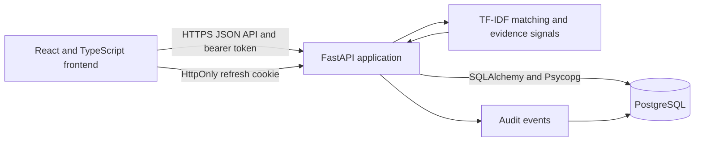
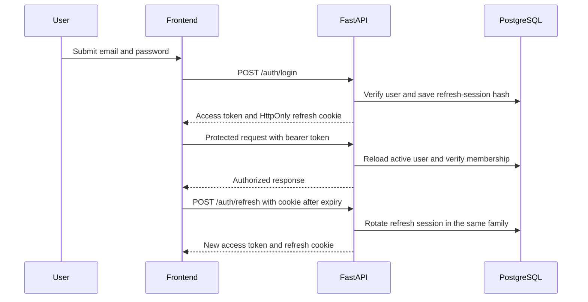
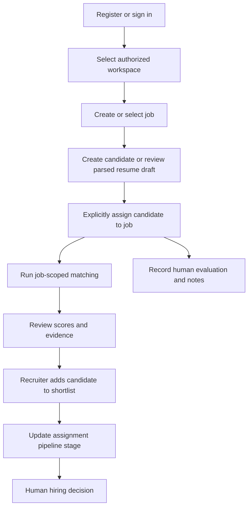
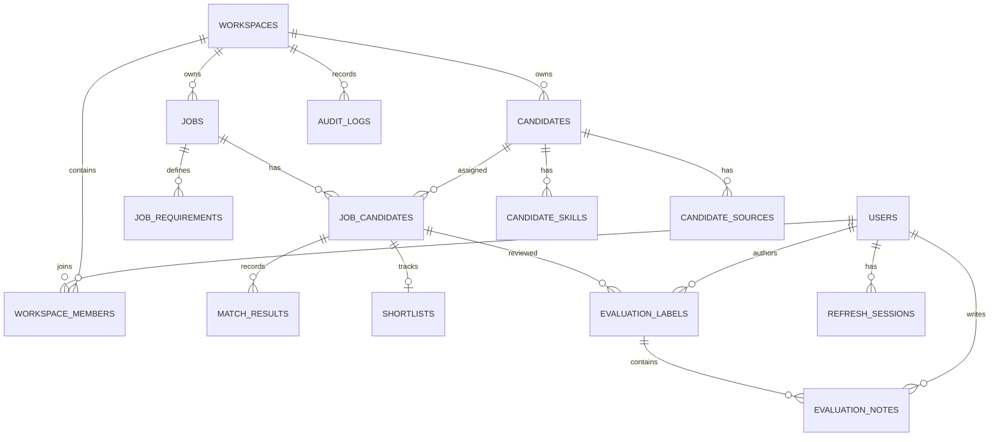

# AI Recruitment Platform

A workspace-scoped recruitment application for managing jobs, candidate profiles, job assignments, matching evidence, evaluations, shortlists, and pipeline stages. It combines a React and TypeScript frontend with a FastAPI API and PostgreSQL persistence.

The platform helps recruiters organize candidate review and compare profiles with job requirements. Its matching scores are decision-support signals; recruiters remain responsible for evaluating candidates and making hiring decisions.

## Table of contents

- [Project overview](#project-overview)
- [Key features](#key-features)
- [Application workflow](#application-workflow)
- [Screenshots and interface](#screenshots-and-interface)
- [Technology stack](#technology-stack)
- [Architecture](#architecture)
- [Machine learning methodology](#machine-learning-methodology)
- [Candidate evaluation](#candidate-evaluation)
- [Recruitment pipeline and shortlists](#recruitment-pipeline-and-shortlists)
- [Authentication and security](#authentication-and-security)
- [Database architecture](#database-architecture)
- [API reference](#api-reference)
- [Project structure](#project-structure)
- [Prerequisites](#prerequisites)
- [Installation and setup](#installation-and-setup)
- [Environment variables](#environment-variables)
- [Running the application](#running-the-application)
- [Testing and quality checks](#testing-and-quality-checks)
- [CSV data and migration](#csv-data-and-migration)
- [Deployment](#deployment)
- [Current limitations](#current-limitations)
- [Roadmap](#roadmap)
- [Responsible AI and human oversight](#responsible-ai-and-human-oversight)
- [License](#license)

## Project overview

The AI Recruitment Platform supports early-stage recruitment work for recruiters working in a workspace. Users can maintain jobs and reusable candidate profiles, explicitly associate candidates with jobs, review matching evidence, record human evaluations, manage shortlists, and move assigned candidates through a pipeline.

Matching currently uses TF-IDF and cosine similarity. Separate skill, experience, and location signals provide additional context. The API also calculates an experimental combined score, but TF-IDF remains the ranking signal. The combined score is not a calibrated probability or an automated hiring decision.

Workspace-scoped API operations require an authenticated user and verified membership in the requested workspace. Candidate profiles are separate from job-candidate assignments: assigning a candidate creates a relationship for one job, with its own stage and recruitment history.

## Key features

### Recruitment management

- Create, list, and update workspace jobs.
- Create, list, update, and view workspace candidate profiles.
- Upload PDF or DOCX resumes for in-memory text extraction and draft parsing. A recruiter must review and explicitly save the draft.
- Assign candidates to jobs and manage each job-candidate relationship independently.
- View candidate profile details, assigned jobs, stages, and stored match results.

### AI and matching

- Rank assigned candidates using TF-IDF cosine similarity.
- Report skill coverage, experience compatibility, and location compatibility separately.
- Show matched and missing required skills in stored matching evidence.
- Calculate a combined score using fixed, documented weights. This score is experimental and does not determine ranking.
- Preserve a record of matching results against the existing job-candidate assignment.

### Recruitment workflow

- Track assignments through `SOURCED`, `REVIEWING`, `SHORTLISTED`, `REJECTED`, and `HIRED`.
- Add and remove shortlist entries without deleting reusable candidate profiles.
- Synchronize shortlist status when the pipeline stage changes.
- Record human relevance labels and reviewer-authored notes per job-candidate pair.
- Write audit events for matching runs, evaluation writes, shortlist operations, and shortlist synchronization.

### Workspace and team management

- View available workspaces and workspace details.
- View workspace members and their assigned roles.
- Add existing registered users to a workspace using their email address.
- Update member roles between `ADMIN` and `RECRUITER`.
- Remove members from a workspace.
- Rename workspaces with automatic slug regeneration.
- Restrict administrative actions to users with the `ADMIN` role.
- Provide read-only workspace administration access to `RECRUITER` members.
- Prevent removal or demotion of the last workspace administrator.
- Record workspace administration changes through audit events.

### Platform and security

- Register an account and initial workspace, or sign in to an existing account.
- Use short-lived bearer access tokens and rotating refresh sessions in an HttpOnly cookie.
- Enforce workspace membership for workspace-scoped API operations.
- Support ADMIN and RECRUITER workspace membership roles with distinct permissions. ADMIN members can manage workspace settings and membership, while RECRUITER members have read-only access to workspace administration.
- Hash passwords with Argon2id and store refresh-token hashes rather than plaintext refresh tokens.

### Reporting and utilities

- View workspace dashboard counts, evaluation status, and match-score distributions.
- Validate the bundled job and candidate CSV files.
- Dry-run or transactionally migrate legacy CSV records, with a JSON report and reconciliation details.
- Evaluate TF-IDF rankings against complete human labels using Precision@5, Recall@10, and NDCG@5.
- Export a pandas results DataFrame to an Excel workbook through the Python export utility.
- Generate a Boolean query string from semicolon-delimited skills. The query is not saved or sent to external sources.

## Application workflow

1. **Register or sign in.** Registration creates a user, an initial workspace, and an `ADMIN` membership. Registration does not sign the user in automatically.
2. **Select a workspace.** The frontend loads workspaces available to the authenticated user.
3. **Create a job.** A recruiter provides the job description and requirements.
4. **Create a candidate or parse a resume.** Resume parsing returns a draft; it does not persist or assign a candidate.
5. **Assign the candidate.** A recruiter creates an explicit job-candidate relationship. Candidate profiles can be reused across jobs.
6. **Run matching.** A recruiter requests matching for a selected job. The API considers only candidates already assigned to that job and does not create assignments.
7. **Review matching evidence.** The UI presents TF-IDF scores and separate compatibility signals as decision support.
8. **Record a human evaluation.** A recruiter records a relevance label and optional note for an assigned job-candidate pair.
9. **Manage the shortlist.** A recruiter can shortlist an assigned candidate or remove an active shortlist entry.
10. **Update the pipeline.** A recruiter changes the assignment's stage. The API synchronizes shortlist status as described in [Recruitment pipeline and shortlists](#recruitment-pipeline-and-shortlists).
11. **Make a hiring decision.** The application does not make this decision automatically.

### Workspace administration

Workspace members can view workspace details and the member list. Users with the `ADMIN` role can rename the workspace, add existing registered users, update member roles, and remove members. Users with the `RECRUITER` role have read-only access to workspace and membership information. The application prevents the last workspace administrator from being removed or demoted.

Matching computation and score persistence are automated after a recruiter initiates a run. Candidate assignment, evaluation, shortlisting, stage changes, and hiring decisions require human action.

## Screenshots and interface

The frontend routes include:

- Dashboard
- Jobs and job details
- Candidates and candidate details
- Matching
- Shortlists
- Evaluations
- Pipeline
- Boolean Search
- Settings
- Login, registration, and workspace selection

The `Workspace & Team` section provides workspace and membership administration. Users can view workspace details and members, while workspace administrators can add existing users, update member roles, remove members, and rename the workspace. Role-based access control restricts administrative actions to users with the `ADMIN` role, while `RECRUITER` members have read-only access. The application also includes safeguards against removing or demoting the last workspace administrator. No maintained screenshot assets are currently included in the repository.

## Technology stack

Versions below reflect the declared project constraints or frontend package manifest, not a claim that every deployment uses a specific patch version.

| Area | Technology | Declared version or constraint |
|---|---|---|
| Runtime | Python | `>=3.10` |
| API | FastAPI | `>=0.115,<1` |
| Data validation | Pydantic | Version 2 APIs are used through FastAPI |
| ORM | SQLAlchemy | `>=2.0,<2.1` |
| Database | PostgreSQL | PostgreSQL-first persistence via Psycopg 3 |
| Schema migrations | Alembic | `>=1.13` |
| Authentication | PyJWT | `>=2.8,<3` |
| Password hashing | argon2-cffi | `>=23.1` |
| Data analysis | pandas | `>=2.0` |
| Machine learning | scikit-learn | `>=1.4` |
| Backend server | Uvicorn | `>=0.30,<1` |
| Frontend | React | `^19.3.1` |
| Frontend language | TypeScript | `~7.0.2` |
| Frontend build tooling | Vite | `^8.3.5` |
| Styling | Tailwind CSS | `^4.3.3` |
| API state and caching | TanStack Query | `^5.105.0` |
| HTTP client | Axios | `^1.21.0` |
| Backend tests and lint | pytest, Ruff | pytest `>=8.0`; Ruff `>=0.5` in the `dev` extra |
| Frontend tests | Vitest | `^5.0.5` |
| Frontend hosting configuration | Vercel | Frontend SPA rewrite is in `frontend/vercel.json` |

## Architecture

### High-level system architecture



### Frontend and API communication

The React application is mounted from `frontend/src/main.tsx` and routes are declared in `frontend/src/App.tsx`. Feature API modules use a shared Axios client. TanStack Query manages asynchronous reads, caching, mutation state, and query invalidation.

The client uses `VITE_API_BASE_URL` as its API base URL, defaulting to `http://localhost:8000`. It sends credentials for refresh-cookie requests and attaches the in-memory access token as a bearer token. A `401` response can trigger a single shared refresh request before retrying the original request.

The FastAPI application is created in `src/ml_project/api/main.py`. Routers are organized by authentication, workspaces, job and candidate records, matching, evaluations, and shortlists. Request and response shapes are defined in `src/ml_project/api/schemas.py`.

### Authentication and refresh-token flow



### Recruitment workflow



## Machine learning methodology

The production matching baseline is implemented in `src/ml_project/matching.py`.

1. The job text is the job description.
2. Each candidate profile text concatenates the candidate's current title, summary, and skills.
3. A `TfidfVectorizer` fits on the job description and the eligible candidate profile texts. It uses the token pattern `(?u)\b\w+\b`.
4. Cosine similarity is calculated between the job vector and each candidate vector.
5. Results are ordered by descending similarity using a stable sort. Empty candidate input returns an empty result; missing or tokenless text produces zero similarity rather than a model score.
6. The API first selects `JobCandidate` rows for the requested workspace and job. Only explicitly assigned candidates participate. Matching upserts results for those existing assignments; it never creates or modifies assignments.

`src/ml_project/matching_signals.py` calculates evidence separately from the ranking:

- **Skill coverage:** exact normalized term comparison of required and candidate skills, with a small alias map (for example, `js` and `javascript`). Coverage is the number of matched required terms divided by the number of required terms. An empty requirement list yields zero coverage.
- **Experience compatibility:** `Meets minimum`, `Below minimum`, or `Unknown` if either value is absent or not numeric.
- **Location compatibility:** `Exact match`, `Remote compatible`, `Different location`, or `Unknown`. Remote compatibility is reported when the job location explicitly contains “remote.”

The API also stores an experimental combined score using this formula:

```text
100 * (
    0.40 * tfidf_similarity
  + 0.35 * skill_coverage_fraction
  + 0.15 * experience_score
  + 0.10 * location_score
)
```

`experience_score` is `1.0` only when the experience signal is `Meets minimum`; otherwise it is `0.0`. `location_score` is `1.0` for an exact match, `0.7` for remote-compatible, and `0.0` for different or unknown locations. The result is clamped to 0–100. TF-IDF remains the ranking basis; this combined score is experimental, is not a calibrated probability, and is not used to make hiring decisions.

Semantic matching is not active. The response and database include a nullable semantic-similarity field, but the current matching implementation returns it as `null`. The standalone RandomForest classifier in `src/ml_project/modeling.py` is a separate tabular-classification example and is not the recruitment matching model.

## Candidate evaluation

The application supports human-provided relevance values for an existing job-candidate assignment:

| Label | Meaning |
|---:|---|
| 0 | Not relevant |
| 1 | Partially relevant |
| 2 | Relevant |

The API returns both evaluated assignments and assignments needing human review. Each reviewer owns their label and notes for a job-candidate pair; another reviewer's evaluation is visible but read-only to the current reviewer. Notes are stored separately and may be created or updated by their author. Updates use `expected_updated_at` for optimistic concurrency; stale writes return a conflict rather than silently overwriting newer work.

The standalone ranking evaluation is in `src/ml_project/evaluation.py`. It computes:

- **Precision@5:** number of fully relevant (`2`) candidates in the top five divided by five.
- **Recall@10:** fully relevant candidates found in the top ten divided by all fully relevant candidates.
- **NDCG@5:** normalized discounted cumulative gain using graded labels 0, 1, and 2, with gain `(2^label - 1) / log2(rank + 2)`.

Metrics are only calculated for a job when the ranking and labels form a complete, valid set with no duplicate pair labels. Incomplete jobs are marked `incomplete_labels` and their metrics remain unavailable. Complete empty rankings are marked `empty_ranking`. The report includes per-job results and a macro-average over fully labeled jobs, written by default to `reports/baseline_evaluation.csv`.

`src/ml_project/evaluation_review.py` provides CSV-based review helpers. These operate on the legacy `data/evaluation.csv` and optional `data/evaluation_notes.csv`; they are distinct from the authenticated API review workflow.

## Recruitment pipeline and shortlists

Pipeline stages belong to the job-candidate assignment, not the reusable candidate profile. The API accepts exactly these stages:

| Stored value | Display meaning |
|---|---|
| `SOURCED` | Sourced |
| `REVIEWING` | Reviewing |
| `SHORTLISTED` | Shortlisted |
| `REJECTED` | Rejected |
| `HIRED` | Hired |

A candidate must be explicitly assigned to a job before being shortlisted. The API prevents duplicate active shortlist entries and allows a previously removed entry to be reactivated. Shortlisting also sets the assignment stage to `SHORTLISTED`.

Changing an assignment stage synchronizes its shortlist record:

- Moving to `SHORTLISTED` creates or reactivates an `ACTIVE` shortlist entry.
- Moving to `HIRED` creates or marks the entry `HIRED`.
- Moving to `SOURCED`, `REVIEWING`, or `REJECTED` marks an `ACTIVE` or `HIRED` shortlist entry `REMOVED`.

Manual shortlist removal marks the shortlist record `REMOVED`; it does not delete the candidate profile or job assignment. Manual removal does not itself reset the assignment's stage. A `HIRED` shortlist entry cannot be removed through the manual delete endpoint. Audit events record shortlist changes and pipeline-driven synchronization.

Deleting an assignment does not delete the reusable candidate profile. The API blocks assignment removal while matching, shortlist, or evaluation history exists, preserving historical recruitment records.

## Authentication and security

### Credentials and sessions

- Passwords are hashed with Argon2id using `argon2-cffi`.
- Registration requires a password with at least eight characters.
- Access tokens are HS256 JWTs with subject, issue time, expiry, issuer, and audience claims. The default lifetime is 15 minutes; the configured maximum is 60 minutes.
- Refresh tokens are sent in an HttpOnly cookie and stored in the database as hashes. The default lifetime is seven days; the maximum is 30 days.
- Refresh rotates the token within its family. Reuse of a revoked refresh token revokes active sessions in that family.
- Logout revokes the presented refresh session when present and clears the cookie.
- In production, the refresh cookie must be Secure and `REFRESH_TOKEN_HASH_SECRET` must be configured.
- The frontend stores the access token in module memory rather than persistent browser storage.

### Authorization and request protections

- Protected API requests require a valid bearer token and an active user.
- Workspace endpoints verify authenticated workspace membership and enforce role-based permissions. Administrative operations require the ADMIN role, while RECRUITER members have read-only access to workspace and membership information.
- CORS origins are explicit; wildcard origins are rejected. In production, `CORS_ALLOWED_ORIGINS` must be set.
- Login uses an in-memory, per-process fixed-window limiter. Defaults are five failed attempts per client key per 60 seconds. It is not a shared distributed rate limiter.
- When a request supplies an `Origin` header, login, refresh, and logout accept only configured origins. Requests without an Origin header are allowed.
- Resume uploads accept PDF and DOCX files, validate file signatures, enforce a configurable size limit (10 MiB by default), and extract text in memory. Parsing returns a draft and does not automatically save a profile.
- Production API documentation endpoints (`/docs`, `/redoc`, and `/openapi.json`) are disabled.

## Database architecture

SQLAlchemy models are defined in `src/ml_project/models.py`. PostgreSQL is the primary database; Alembic manages versioned schema changes. The central relation is `job_candidates`, which connects a workspace job and candidate and owns their stage, matching results, shortlist record, and evaluation labels.

| Table | Purpose and relationships |
|---|---|
| `users` | User identities and password hashes; related to memberships, refresh sessions, reviews, and audit events. |
| `workspaces` | Workspace ownership boundary; related to members, jobs, candidates, assignments, and audit events. |
| `workspace_members` | Unique user membership in a workspace with `ADMIN` or `RECRUITER` role. |
| `jobs` | Workspace-scoped job records; related to requirements and assignments. |
| `job_requirements` | Job requirements, including required-skill rows. |
| `candidates` | Reusable workspace candidate profiles; related to skills, sources, and job assignments. |
| `candidate_skills` | Skills belonging to a candidate profile. |
| `candidate_sources` | Candidate source provenance and authorized-basis metadata. |
| `job_candidates` | Explicit job-candidate relationship, unique per job and candidate; owns the stage and recruitment history. |
| `match_results` | Matching evidence attached to an assignment and model version. |
| `shortlists` | One reusable shortlist record per assignment, with `ACTIVE`, `REMOVED`, or `HIRED` status. |
| `evaluation_labels` | Reviewer-owned relevance label for an assignment. |
| `evaluation_notes` | Notes attached to an evaluation label and authored by a user. |
| `refresh_sessions` | Refresh-token hashes, family identifiers, expiry, and revocation timestamps. |
| `audit_logs` | Workspace-scoped actor, action, entity, and structured details for audited mutations. |
| `search_queries` | Modeled Boolean-search query storage; no API currently persists or retrieves these records. |
| `sourcing_tasks` | Modeled sourcing-task storage; no active source connectors or background sourcing routes currently use it. |

### Core relationship diagram



## API reference

All routes below are registered by the FastAPI application. Unless marked public or cookie-authenticated, endpoints require a bearer access token. Workspace record routes also require membership in the supplied workspace. IDs are UUIDs.

### Authentication

| Method | Endpoint | Access | Description |
|---|---|---|---|
| `POST` | `/auth/register` | Public | Create a user, initial workspace, and `ADMIN` membership. The user must sign in separately. |
| `POST` | `/auth/login` | Public | Verify credentials, return an access token, and set a refresh cookie. |
| `POST` | `/auth/refresh` | Refresh cookie | Rotate the refresh session and return a new access token. |
| `POST` | `/auth/logout` | Refresh cookie, if present | Revoke the presented refresh session and clear its cookie. |
| `GET` | `/auth/me` | Bearer token | Return the active user's public profile. |

### Workspaces

| Method | Endpoint | Access | Description |
|---|---|---|---|
| `GET` | `/workspaces` | Bearer token | List workspaces the current user belongs to, including the membership role. |
| `GET` | `/workspaces/{workspace_id}` | Bearer token and workspace membership | Retrieve workspace details, including its name and slug. |
| `GET` | `/workspaces/{workspace_id}/members` | Bearer token and workspace membership | List members of the specified workspace, including their roles. |
| `POST` | `/workspaces/{workspace_id}/members` | Bearer token and ADMIN role | Add an existing registered user to the workspace using their email address. |
| `PATCH` | `/workspaces/{workspace_id}` | Bearer token and ADMIN role | Rename the workspace and regenerate its slug. |
| `PATCH` | `/workspaces/{workspace_id}/members/{user_id}` | Bearer token and ADMIN role | Update a workspace member's role between `ADMIN` and `RECRUITER`. |
| `DELETE` | `/workspaces/{workspace_id}/members/{user_id}` | Bearer token and ADMIN role | Remove a member from the workspace. The last workspace administrator cannot be removed. |

### Jobs and candidates

| Method | Endpoint | Access | Description |
|---|---|---|---|
| `POST` | `/jobs` | Bearer token and workspace membership | Create a job and its required-skill requirements. |
| `GET` | `/jobs?workspace_id={id}` | Bearer token and workspace membership | List jobs in the workspace with assignment counts. |
| `PUT` | `/jobs/{job_id}` | Bearer token and workspace membership | Update job fields and requirements. |
| `POST` | `/candidates` | Bearer token and workspace membership | Create a reusable candidate profile without assigning it. |
| `GET` | `/candidates?workspace_id={id}` | Bearer token and workspace membership | List candidate profiles in the workspace. |
| `GET` | `/candidates/{candidate_id}?workspace_id={id}` | Bearer token and workspace membership | Return a profile, its assigned jobs, stages, and stored matching summaries. |
| `PUT` | `/candidates/{candidate_id}` | Bearer token and workspace membership | Update a reusable candidate profile without changing assignments. |
| `POST` | `/candidates/resume` | Bearer token and workspace membership | Upload a PDF or DOCX as multipart form data (`workspace_id`, `file`) and return a parsed draft. |

### Candidate assignments

| Method | Endpoint | Access | Description |
|---|---|---|---|
| `GET` | `/jobs/{job_id}/candidates?workspace_id={id}` | Bearer token and workspace membership | List only candidates explicitly assigned to that job. |
| `POST` | `/jobs/{job_id}/candidates` | Bearer token and workspace membership | Assign an existing workspace candidate to the job. Body: `workspace_id`, `candidate_id`. |
| `DELETE` | `/jobs/{job_id}/candidates/{candidate_id}?workspace_id={id}` | Bearer token and workspace membership | Remove an assignment only when no historical matching, shortlist, or evaluation data prevents removal. |
| `PATCH` | `/jobs/{job_id}/candidates/{candidate_id}?workspace_id={id}` | Bearer token and workspace membership | Change the assignment stage. Body: `{"stage":"REVIEWING"}`. This also synchronizes shortlist state. |

### Matching

| Method | Endpoint | Access | Description |
|---|---|---|---|
| `POST` | `/matching/run` | Bearer token and workspace membership | Run TF-IDF matching for a job using only its existing assignments. Body: `workspace_id`, `job_id`. |
| `GET` | `/matching?workspace_id={id}&job_id={id}` | Bearer token and workspace membership | Retrieve stored matching results, optionally filtered to one job. |
| `GET` | `/matching/score-distribution?workspace_id={id}` | Bearer token and workspace membership | Return workspace score histograms for TF-IDF and the experimental combined score. |

### Shortlists

| Method | Endpoint | Access | Description |
|---|---|---|---|
| `POST` | `/shortlists` | Bearer token and workspace membership | Add or reactivate an assigned job-candidate pair. Body: `workspace_id`, `job_id`, `candidate_id`. |
| `GET` | `/shortlists?workspace_id={id}&job_id={id}` | Bearer token and workspace membership | List active shortlist entries, optionally filtered by job. |
| `DELETE` | `/shortlists/{shortlist_id}?workspace_id={id}` | Bearer token and workspace membership | Mark an entry removed; a `HIRED` entry cannot be removed. |

### Evaluations

| Method | Endpoint | Access | Description |
|---|---|---|---|
| `GET` | `/evaluations?workspace_id={id}` | Bearer token and workspace membership | Return assigned pairs, labels, reviewer identities, notes, and pending review state. |
| `PUT` | `/evaluations` | Bearer token and workspace membership | Create or update the current reviewer's label and optional note for an existing assigned pair. The request includes `workspace_id`, `job_id`, `candidate_id`, `review_status`, `relevance_label`, `note`, `note_id`, and `expected_updated_at` as applicable. |

### Health

| Method | Endpoint | Access | Description |
|---|---|---|---|
| `GET` | `/health` | Public | Return `{"status":"ok"}` for API process health. It does not check database connectivity. |

For local development, interactive API documentation is available at `http://127.0.0.1:8000/docs`. It is disabled when `ENV=production`.

## Project structure

```text
.
├── api/
│   └── index.py
├── data/
│   ├── candidates.csv
│   ├── evaluation.csv
│   ├── evaluation_notes.csv
│   └── jobs.csv
├── frontend/
│   ├── src/
│   │   ├── components/
│   │   │   └── shared/
│   │   │       ├── ConfirmationDialog.tsx
│   │   │       └── StyledSelect.tsx
│   │   ├── features/
│   │   │   ├── auth/
│   │   │   └── workspaces/
│   │   │       ├── api.ts
│   │   │       └── api.test.ts
│   │   ├── pages/
│   │   │   ├── WorkspaceTeamPage.tsx
│   │   │   └── WorkspaceTeamPage.test.tsx
│   │   ├── services/
│   │   ├── App.tsx
│   │   └── ...
│   ├── vercel.json
│   ├── vite.config.ts
│   └── package.json
├── migrations/
│   ├── env.py
│   └── versions/
├── reports/
├── scripts/
│   └── dev.js
├── src/
│   └── ml_project/
│       ├── api/
│       │   ├── routers/
│       │   │   ├── auth.py
│       │   │   └── workspaces.py
│       │   ├── dependencies.py
│       │   ├── schemas.py
│       │   └── workspace_slugs.py
│       ├── audit.py
│       ├── bootstrap_admin.py
│       ├── config.py
│       ├── csv_migration.py
│       ├── database.py
│       ├── dataset_validation.py
│       ├── evaluation.py
│       ├── evaluation_review.py
│       ├── matching.py
│       ├── matching_signals.py
│       ├── modeling.py
│       ├── models.py
│       └── security.py
├── tests/
│   ├── postgres/
│   │   ├── conftest.py
│   │   ├── test_workspaces.py
│   │   └── test_workspace_concurrency.py
│   ├── __init__.py
│   └── test_workspaces_api.py
├── .env.example
├── alembic.ini
├── pyproject.toml
├── README.md
└── requirements.txt
```

## Prerequisites

- Python 3.10 or newer.
- Node.js `^20.19.0` or `>=22.12.0` for the declared Vite 8 toolchain.
- npm.
- PostgreSQL and a database/user accessible through `DATABASE_URL`.
- Git.

## Installation and setup

### Clone the repository

```powershell
git clone https://github.com/RR0CKY69/ai-recruitment-platform.git
Set-Location ai-recruitment-platform
```

### Create and activate a Python environment

```powershell
python -m venv .venv
.\.venv\Scripts\Activate.ps1
```

If PowerShell prevents environment activation, call the environment's Python executable directly in the commands below:

```powershell
.\.venv\Scripts\python.exe -m pip install -r requirements.txt
```

Install the optional development tools when running backend tests or Ruff:

```powershell
.\.venv\Scripts\python.exe -m pip install -e ".[dev]"
```

### Install frontend dependencies

```powershell
npm --prefix frontend ci
```

### Configure PostgreSQL and environment

Create a PostgreSQL database and user. Configure `DATABASE_URL` in `.env` using a Psycopg SQLAlchemy URL; URL-encode any special characters in the password:

```text
postgresql+psycopg://<database-user>:<url-encoded-password>@localhost:1234/<database-name>
```

Create `.env` from the example only when a local file does not already exist:

```powershell
if (-not (Test-Path .env)) { Copy-Item .env.example .env }
```

Set `DATABASE_URL` and a private `JWT_SECRET_KEY` with at least 32 UTF-8 bytes. For production, also configure the production-required refresh-token hash secret, secure cookie settings, and explicit CORS origins. See [Environment variables](#environment-variables). Never commit `.env` or use real credentials in documentation.

Apply the versioned schema migrations:

```powershell
.\.venv\Scripts\python.exe -m alembic upgrade head
```

Register through the application or run the interactive bootstrap command against an empty database:

```powershell
.\.venv\Scripts\python.exe -m ml_project.bootstrap_admin
```

The bootstrap command creates the first administrator, workspace, and `ADMIN` membership only if users and workspaces do not already exist. It requires an interactive terminal so passwords can be entered without echo. Registration through the API also creates a workspace and membership, then requires a separate login.

## Environment variables

The backend loads `.env` from the project root. Optional settings below are read by `src/ml_project/config.py`; defaults apply only where stated. Do not place secrets in source control.

| Variable | Purpose | Required | Default or constraints |
|---|---|---:|---|
| `DATABASE_URL` | SQLAlchemy connection string for PostgreSQL | Yes | No default |
| `ENV` | Select development or production behavior | No | `development`; only `development` and `production` are valid |
| `JWT_SECRET_KEY` | HS256 access-token signing secret | Yes | At least 32 UTF-8 bytes; weak/example values are rejected |
| `JWT_ACCESS_TOKEN_MINUTES` | Access-token lifetime | No | `15`; integer from 1 to 60 |
| `JWT_ISSUER` | JWT issuer claim | No | `ml-project-api` |
| `JWT_AUDIENCE` | JWT audience claim | No | `ml-project-clients` |
| `CORS_ALLOWED_ORIGINS` | Comma-separated allowed browser origins | Production: yes | Development defaults to localhost and 127.0.0.1 on port 5173; wildcard is rejected |
| `LOGIN_RATE_LIMIT_ATTEMPTS` | Failed login attempts per fixed window | No | `5`; integer from 1 to 1000 |
| `LOGIN_RATE_LIMIT_WINDOW_SECONDS` | Login rate-limit window | No | `60`; integer from 1 to 86400 |
| `LOGIN_RATE_LIMIT_TRUSTED_PROXIES` | Comma-separated trusted proxy IP networks for client identification | No | Empty; proxy forwarding headers are trusted only from configured networks |
| `REFRESH_TOKEN_DAYS` | Refresh-session lifetime | No | `7`; integer from 1 to 30 |
| `REFRESH_COOKIE_NAME` | Refresh cookie name | No | `refresh_token` |
| `REFRESH_COOKIE_SECURE` | Require HTTPS for refresh cookie | Production: yes | Defaults to true in production and false in development; production rejects false |
| `REFRESH_COOKIE_SAMESITE` | Refresh cookie SameSite policy | No | `Lax`; allowed values are `Lax`, `Strict`, and `None` |
| `REFRESH_COOKIE_PATH` | Refresh cookie path | No | `/` |
| `REFRESH_COOKIE_DOMAIN` | Optional refresh cookie domain | No | Unset |
| `REFRESH_TOKEN_HASH_SECRET` | HMAC secret used when hashing refresh tokens | Production: yes | No default; at least 32 UTF-8 bytes in production |
| `MAX_RESUME_SIZE_BYTES` | Maximum accepted resume upload size | No | `10485760` bytes (10 MiB); positive integer |
| `VITE_API_BASE_URL` | Frontend API base URL | No | `http://localhost:8000` |

## Running the application

### Combined development launcher

The root `npm run dev` script starts the backend and Vite frontend as child processes. It expects `.venv` and `frontend/node_modules` to exist. Use the separate-terminal commands below if the combined launcher is unsuitable for your environment.

```powershell
npm run dev
```

### Separate backend and frontend terminals

From the project root, start the API:

```powershell
.\.venv\Scripts\python.exe -m uvicorn ml_project.api.main:app --reload --host 127.0.0.1 --port 8000
```

In another terminal, start the frontend:

```powershell
npm --prefix frontend run dev -- --host 127.0.0.1 --port 5173 --strictPort
```

Local URLs:

| Service | URL |
|---|---|
| Frontend | `http://127.0.0.1:5173` |
| API | `http://127.0.0.1:8000` |
| Interactive API docs (development only) | `http://127.0.0.1:8000/docs` |
| Health | `http://127.0.0.1:8000/health` |

## Testing and quality checks

Run commands from the repository root unless noted.

### Backend

Install the development extra first, then run:

```powershell
.\.venv\Scripts\python.exe -m pytest
.\.venv\Scripts\python.exe -m ruff check src tests
```

The pytest suite covers API and service behavior, authentication and authorization, matching and matching signals, evaluations and audit records, candidate/job assignment, shortlists, CSV migration, configuration, and database behavior. Tests requiring a real PostgreSQL service are grouped under `tests/postgres/`.

### Frontend

```powershell
npm --prefix frontend test -- --run
npm --prefix frontend run build
```

The frontend test command runs Vitest and the build runs the TypeScript project build before Vite creates the production bundle. To run the TypeScript project check separately:

```powershell
Set-Location frontend
npx tsc -b
Set-Location ..
```

These are documented commands, not a statement that a test or build has passed in a particular environment.

## CSV data and migration

The bundled CSV inputs are:

- `data/jobs.csv`
- `data/candidates.csv`
- `data/evaluation.csv`
- `data/evaluation_notes.csv`

Validate the job and candidate datasets:

```powershell
.\.venv\Scripts\python.exe -m ml_project.dataset_validation
```

The validator checks required columns, missing values, and unique job and candidate IDs.

The CSV migration tool validates the input datasets and writes a JSON report. The dry run does not connect to or modify the database:

```powershell
.\.venv\Scripts\python.exe -m ml_project.csv_migration --dry-run
```

The default report path is `reports/csv_migration_report.json`. Options include `--data-dir` and `--report`.

Before any import, inspect the dry-run report, resolve every validation issue, and verify the target database and workspace. Never run `--execute` against an unverified target. Execution requires an existing active `--reviewer-user-id` and either an existing `--workspace-id`, or both `--create-workspace-name` and `--create-workspace-slug`. Creating a workspace also requires a membership role. For example, use `--workspace-member-role ADMIN` or, in a separate invocation, `--workspace-member-role RECRUITER`.

After review and explicit authorization, an execution command has this shape:

```powershell
.\.venv\Scripts\python.exe -m ml_project.csv_migration `
  --execute `
  --workspace-id "<existing-workspace-uuid>" `
  --reviewer-user-id "<existing-active-user-uuid>"
```

The tool also supports explicit workspace creation options; do not combine them with `--workspace-id`. It performs the import transactionally, maps legacy IDs to database UUIDs, treats matching existing records idempotently, refuses conflicting historical values, and reconciles imported data before commit. Import was not run as part of this documentation.

For an explicitly created workspace, the reviewer is assigned the selected membership role. These are separate examples; choose one role and do not run both examples against the same migration target:

```powershell
.\.venv\Scripts\python.exe -m ml_project.csv_migration `
  --execute `
  --create-workspace-name "Migration Workspace" `
  --create-workspace-slug "migration-workspace" `
  --workspace-member-role ADMIN `
  --reviewer-user-id "<existing-active-user-uuid>"
```

```powershell
.\.venv\Scripts\python.exe -m ml_project.csv_migration `
  --execute `
  --create-workspace-name "Migration Workspace" `
  --create-workspace-slug "migration-workspace" `
  --workspace-member-role RECRUITER `
  --reviewer-user-id "<existing-active-user-uuid>"
```

### Standalone matching and evaluation tools

Rank the sample candidates for a job ID from `data/jobs.csv`:

```powershell
.\.venv\Scripts\python.exe -m ml_project.matching --job-id "<job-id-from-data>"
```

Evaluate the standalone TF-IDF baseline against `data/evaluation.csv` and write the default report:

```powershell
.\.venv\Scripts\python.exe -m ml_project.evaluation
```

Both tools accept a custom `--data-dir`; evaluation also accepts `--output`. The standalone CSV baseline evaluates its CSV candidate set and is separate from the API's workspace- and assignment-scoped workflow.

The separate tabular-classification example can be run with the installed `ml-project` command:

```powershell
ml-project train --data "<input.csv>" --target "<label-column>" --output "<model-file>"
```

It trains a RandomForest classifier inside a scikit-learn preprocessing pipeline. It is not used by the recruitment matching API.

## Deployment

The application is deployed on Vercel, with production deployment connected to the GitHub `main` branch.

- The Python API entrypoint is `api/index.py`; `pyproject.toml` sets the Vercel entrypoint to `api.index:app`.
- `frontend/vercel.json` rewrites frontend paths to `/index.html` for client-side routing.

A deployment can host the frontend and API as separate Vercel projects. Configure the frontend's `VITE_API_BASE_URL` to the deployed API origin. Configure the backend with a reachable PostgreSQL `DATABASE_URL`, `ENV=production`, a strong `JWT_SECRET_KEY`, a strong `REFRESH_TOKEN_HASH_SECRET`, `REFRESH_COOKIE_SECURE=true`, and explicit `CORS_ALLOWED_ORIGINS` containing the frontend origin. Ensure refresh-cookie domain and SameSite settings are compatible with the chosen origins and browser policy.

Provision PostgreSQL separately and apply Alembic migrations with `alembic upgrade head` as part of a controlled release process. Production API docs are disabled by the application. Do not place credentials in the repository or frontend build variables, and do not treat successful local development as deployment verification.

### Production Deployment

- **Hosting:** Vercel.
- **Source control:** GitHub.
- **Production branch:** `main`.
- **Deployment workflow:** Pushing changes to `main` automatically triggers a Vercel deployment.
- **Database:** Neon PostgreSQL.
- **Environment variables:** Production configuration is managed through Vercel project settings.

After each deployment, verify the deployment status in Vercel and test the production application.

Database migrations are managed separately through Alembic and are not automatically executed by the deployment workflow.

## Current limitations

- No external sourcing connectors or active background sourcing jobs are implemented. `SourcingTask` is a modeled table, not a running queue or connector.
- Boolean Search generates query text in the frontend; it does not persist searches or contact external providers. `SearchQuery` is a modeled table without active query endpoints.
- Semantic matching is inactive; semantic similarity is returned as `null`.
- Workspace and membership administration are implemented, including workspace listing, member management, role updates, member removal, and workspace renaming. However, an email-based invitation workflow for users who are not already registered is not implemented. Registration creates the registering user's initial workspace.
- `ADMIN` and `RECRUITER` memberships have distinct permissions. Workspace administration actions are restricted to `ADMIN` members, while `RECRUITER` members have read-only access to workspace and membership information.
- The login rate limiter is held in process memory and is not shared across multiple backend workers.
- The experimental combined score is not validated, calibrated, or used to rank candidates.
- The standalone RandomForest example is unrelated to production candidate matching.
- Resume parsing is heuristic text extraction and draft construction, not a guaranteed structured parser. Human review and explicit profile creation are required.
- `/health` reports API process health only; it does not test the database.

## Roadmap

The following are potential future improvements, not claims about current functionality:

- Add external sourcing integrations and a durable background task system.
- Add persisted Boolean Search functionality only alongside a defined data and provider contract.
- Evaluate future matching signals against sufficiently complete human-reviewed data before considering them for ranking.
- Add email-based workspace invitations for users who are not already registered.
- Improve deployment automation and operational monitoring as production requirements evolve.

## Responsible AI and human oversight

Matching scores are evidence to help organize recruiter review. They are not hiring probabilities, objective measures of a person's worth, or recommendations to hire or reject. Skill coverage and compatibility signals are literal, limited comparisons and may not capture context or transferable experience.

Human reviewers provide relevance labels and notes; these labels are evaluation data, not ground truth about a person's potential. Recruiters must review source information, verify candidate-provided details, and make decisions using appropriate job-related criteria. Handle candidate records and resumes only with an authorized basis, restrict workspace access, and follow applicable privacy, retention, and employment laws.

The application does not make or automate hiring decisions.

## License

No license file is currently provided in the repository. Contact the repository owner for permission before using, modifying, or distributing this project.
